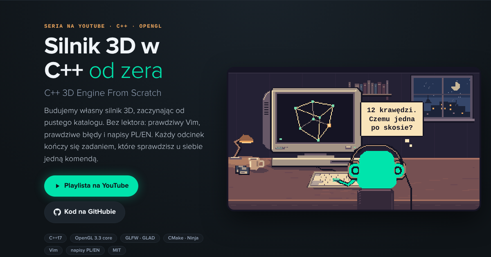
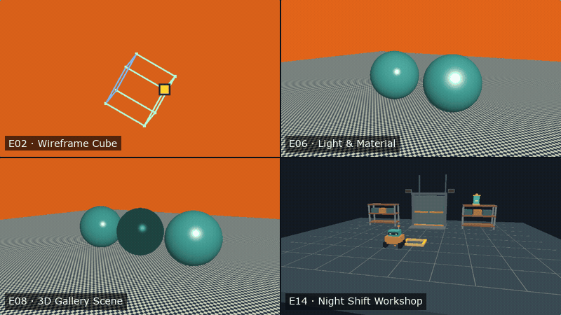
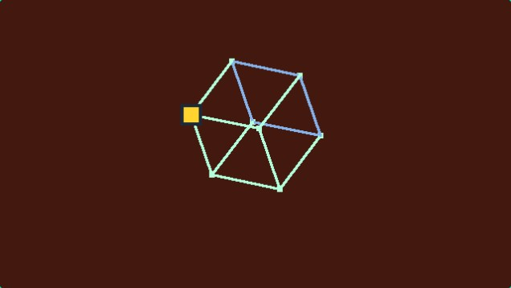
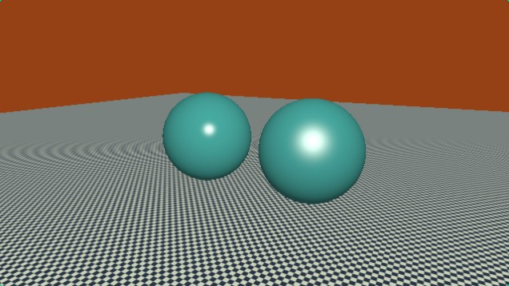
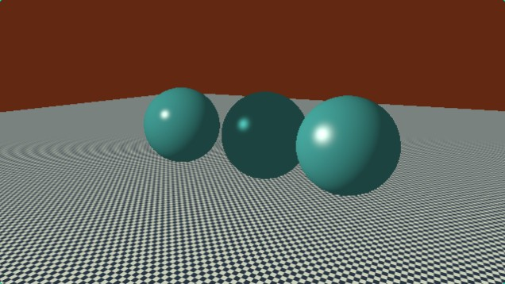
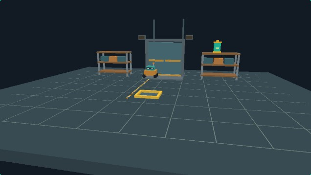
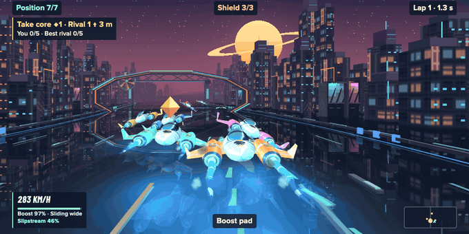
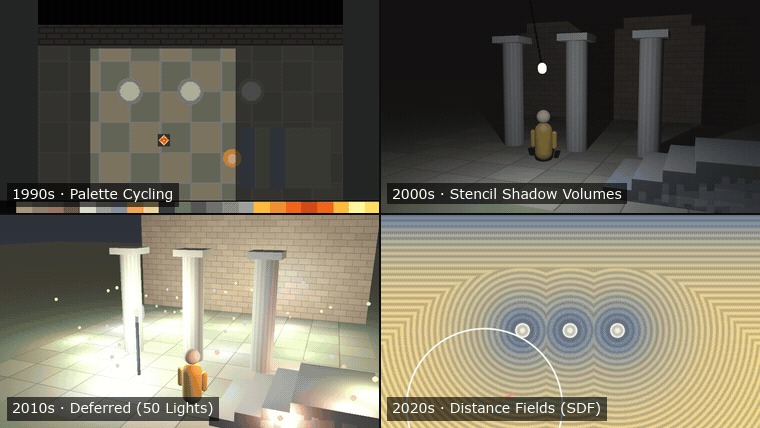

<div align="center">

# C++ 3D Engine From Scratch

**From an empty folder to a 3D engine in C++17 & OpenGL 3.3 — real Vim, real bugs, hands-on exercises after every episode, and live WebAssembly builds in the browser.**

[**Series Website ↗**](https://gamedevpl.github.io/silnik3d-od-zera/) · [**YouTube Playlist ↗**](https://www.youtube.com/playlist?list=PLFf6J3zhiCW4) · [Polski README](README.md) · [Neon Canal Demo](demko/README.md) · [Lumen Lab](docs/lumen-lab/README.md)


-f59e0b?style=flat-square)

<br>

<a href="https://gamedevpl.github.io/silnik3d-od-zera/">
  
</a>

</div>

---

## Engine evolution — run any episode in your browser

Every episode tag (`ep00`–`ep14`) compiles automatically with Emscripten to WebAssembly, so you can try the engine at any milestone with zero setup:

<p align="center">
  <a href="https://gamedevpl.github.io/silnik3d-od-zera/play/?ep=ep14&lang=en">
    
  </a>
</p>

<table>
  <tr>
    <td align="center" width="25%">
      <a href="https://gamedevpl.github.io/silnik3d-od-zera/play/?ep=ep02&lang=en"></a><br>
      <sub><b><a href="https://gamedevpl.github.io/silnik3d-od-zera/play/?ep=ep02&lang=en">E02 · Cube ↗</a></b><br>Rotations &amp; gimbal lock</sub>
    </td>
    <td align="center" width="25%">
      <a href="https://gamedevpl.github.io/silnik3d-od-zera/play/?ep=ep06&lang=en"></a><br>
      <sub><b><a href="https://gamedevpl.github.io/silnik3d-od-zera/play/?ep=ep06&lang=en">E06 · Lighting ↗</a></b><br>Normals &amp; roughness</sub>
    </td>
    <td align="center" width="25%">
      <a href="https://gamedevpl.github.io/silnik3d-od-zera/play/?ep=ep08&lang=en"></a><br>
      <sub><b><a href="https://gamedevpl.github.io/silnik3d-od-zera/play/?ep=ep08&lang=en">E08 · Scene ↗</a></b><br>Handles &amp; lit gallery</sub>
    </td>
    <td align="center" width="25%">
      <a href="https://gamedevpl.github.io/silnik3d-od-zera/play/?ep=ep14&lang=en"></a><br>
      <sub><b><a href="https://gamedevpl.github.io/silnik3d-od-zera/play/?ep=ep14&lang=en">E14 · Night Shift ↗</a></b><br>Season 2: first game</sub>
    </td>
  </tr>
</table>

---

## Companion projects in this repository

<table>
  <tr>
    <td align="center" width="50%" valign="top">
      <a href="./demko/README.md"></a><br>
      <b><a href="./demko/README.md">Neon Canal (Demo)</a></b> · <a href="https://gamedevpl.github.io/silnik3d-od-zera/demko/">Play in browser ↗</a><br>
      <sub>3D C++17 / WASM &amp; native macOS Metal anti-gravity racer — 7 ships, split routes, slipstream slingshots, and core relay.</sub>
    </td>
    <td align="center" width="50%" valign="top">
      <a href="./docs/lumen-lab/README.md"></a><br>
      <b><a href="./docs/lumen-lab/README.md">Lumen Lab</a></b> · <a href="https://gamedevpl.github.io/silnik3d-od-zera/lumen-lab/">Launch WebGL2 ↗</a><br>
      <sub>40 years of real-time light &amp; shadow in one scene (31 live WebGL2 shots: palettes, blobs, lightmaps, volumes, shadow maps, deferred, path tracing, SDFs).</sub>
    </td>
  </tr>
</table>

---

## Episode exercises

Clone any episode's start branch — you get the exact code from the video with one broken piece and a `check.py` script that tests your fix:

```sh
git clone -b e00-start https://github.com/gamedevpl/silnik3d-od-zera.git
cd silnik3d-od-zera
python3 check.py
```

*With the extracted offline kit, replace the HTTPS URL with `silnik-3d.bundle silnik3d-od-zera`. E00–E02 need Git, Python 3, and a C++17 compiler; E03+ also need CMake 3.20+, Ninja, and an OpenGL 3.3 session (Debian/Ubuntu: `sudo apt install pkg-config xorg-dev libwayland-dev libxkbcommon-dev`).*

### Season 1 — From an empty folder to a 3D scene (`E00`–`E08`)

| Episode | Task | Start | Solution | Tag | Browser |
| --- | --- | --- | --- | --- | --- |
| **E00** · The First Window | Make the background pulse again in `frame.hpp` | [`e00-start`](https://github.com/gamedevpl/silnik3d-od-zera/tree/e00-start) | [`e00-solution`](https://github.com/gamedevpl/silnik3d-od-zera/tree/e00-solution) | [`ep00`](https://github.com/gamedevpl/silnik3d-od-zera/tree/ep00) | [Play ↗](https://gamedevpl.github.io/silnik3d-od-zera/play/?ep=ep00&lang=en) |
| **E01** · Game Loop & Fixed Timestep | Cap catch-up time after a long frame in `clock.hpp` | [`e01-start`](https://github.com/gamedevpl/silnik3d-od-zera/tree/e01-start) | [`e01-solution`](https://github.com/gamedevpl/silnik3d-od-zera/tree/e01-solution) | [`ep01`](https://github.com/gamedevpl/silnik3d-od-zera/tree/ep01) | [Play ↗](https://gamedevpl.github.io/silnik3d-od-zera/play/?ep=ep01&lang=en) |
| **E02** · Cube & Gimbal Lock | Straighten the side edges of the cube in `mesh.hpp` | [`e02-start`](https://github.com/gamedevpl/silnik3d-od-zera/tree/e02-start) | [`e02-solution`](https://github.com/gamedevpl/silnik3d-od-zera/tree/e02-solution) | [`ep02`](https://github.com/gamedevpl/silnik3d-od-zera/tree/ep02) | [Play ↗](https://gamedevpl.github.io/silnik3d-od-zera/play/?ep=ep02&lang=en) |
| **E03** · The First Solid Face | Draw the third triangle vertex in `face.hpp` | [`e03-start`](https://github.com/gamedevpl/silnik3d-od-zera/tree/e03-start) | [`e03-solution`](https://github.com/gamedevpl/silnik3d-od-zera/tree/e03-solution) | [`ep03`](https://github.com/gamedevpl/silnik3d-od-zera/tree/ep03) | [Play ↗](https://gamedevpl.github.io/silnik3d-od-zera/play/?ep=ep03&lang=en) |
| **E04** · Camera and Depth | Enable the depth test in `depth.hpp` | [`e04-start`](https://github.com/gamedevpl/silnik3d-od-zera/tree/e04-start) | [`e04-solution`](https://github.com/gamedevpl/silnik3d-od-zera/tree/e04-solution) | [`ep04`](https://github.com/gamedevpl/silnik3d-od-zera/tree/ep04) | [Play ↗](https://gamedevpl.github.io/silnik3d-od-zera/play/?ep=ep04&lang=en) |
| **E05** · Texture in Motion | Pick a mipmap filter in `texture.hpp` | [`e05-start`](https://github.com/gamedevpl/silnik3d-od-zera/tree/e05-start) | [`e05-solution`](https://github.com/gamedevpl/silnik3d-od-zera/tree/e05-solution) | [`ep05`](https://github.com/gamedevpl/silnik3d-od-zera/tree/ep05) | [Play ↗](https://gamedevpl.github.io/silnik3d-od-zera/play/?ep=ep05&lang=en) |
| **E06** · Light and Material | Pass the right roughness uniform in `lighting.hpp` | [`e06-start`](https://github.com/gamedevpl/silnik3d-od-zera/tree/e06-start) | [`e06-solution`](https://github.com/gamedevpl/silnik3d-od-zera/tree/e06-solution) | [`ep06`](https://github.com/gamedevpl/silnik3d-od-zera/tree/ep06) | [Play ↗](https://gamedevpl.github.io/silnik3d-od-zera/play/?ep=ep06&lang=en) |
| **E07** · Mesh as a Resource | Reuse one mesh read across paths in `asset_cache.hpp` | [`e07-path-start`](https://github.com/gamedevpl/silnik3d-od-zera/tree/e07-path-start) | [`e07-solution`](https://github.com/gamedevpl/silnik3d-od-zera/tree/e07-solution) | [`ep07`](https://github.com/gamedevpl/silnik3d-od-zera/tree/ep07) | [Play ↗](https://gamedevpl.github.io/silnik3d-od-zera/play/?ep=ep07&lang=en) |
| **E08** · Scene & Handles | Reject stale-generation handles in `scene.hpp` | [`e08-start`](https://github.com/gamedevpl/silnik3d-od-zera/tree/e08-start) | [`e08-solution`](https://github.com/gamedevpl/silnik3d-od-zera/tree/e08-solution) | [`ep08`](https://github.com/gamedevpl/silnik3d-od-zera/tree/ep08) | [Play ↗](https://gamedevpl.github.io/silnik3d-od-zera/play/?ep=ep08&lang=en) |

### Season 2 · Night Shift — first game on the engine (`E09`–`E14`)

| Episode | Task | Start | Solution | Tag | Browser |
| --- | --- | --- | --- | --- | --- |
| **E09** · The Robot's First Drive | Normalize diagonal speed in `drive.hpp` | [`e09-start`](https://github.com/gamedevpl/silnik3d-od-zera/tree/e09-start) | [`e09-solution`](https://github.com/gamedevpl/silnik3d-od-zera/tree/e09-solution) | [`ep09`](https://github.com/gamedevpl/silnik3d-od-zera/tree/ep09) | [Play ↗](https://gamedevpl.github.io/silnik3d-od-zera/play/?ep=ep09&lang=en) |
| **E10** · The Wall | Slide along the shelf on separate axes in `collision.hpp` | [`e10-start`](https://github.com/gamedevpl/silnik3d-od-zera/tree/e10-start) | [`e10-solution`](https://github.com/gamedevpl/silnik3d-od-zera/tree/e10-solution) | [`ep10`](https://github.com/gamedevpl/silnik3d-od-zera/tree/ep10) | [Play ↗](https://gamedevpl.github.io/silnik3d-od-zera/play/?ep=ep10&lang=en) |
| **E11** · Pick Up the Cell | Edge-trigger key `E` on hold in `cell.hpp` | [`e11-start`](https://github.com/gamedevpl/silnik3d-od-zera/tree/e11-start) | [`e11-solution`](https://github.com/gamedevpl/silnik3d-od-zera/tree/e11-solution) | [`ep11`](https://github.com/gamedevpl/silnik3d-od-zera/tree/ep11) | [Play ↗](https://gamedevpl.github.io/silnik3d-od-zera/play/?ep=ep11&lang=en) |
| **E12** · Power the Workshop | Require all four cell edges inside the socket in `socket.hpp` | [`e12-start`](https://github.com/gamedevpl/silnik3d-od-zera/tree/e12-start) | [`e12-solution`](https://github.com/gamedevpl/silnik3d-od-zera/tree/e12-solution) | [`ep12`](https://github.com/gamedevpl/silnik3d-od-zera/tree/ep12) | [Play ↗](https://gamedevpl.github.io/silnik3d-od-zera/play/?ep=ep12&lang=en) |
| **E13** · One Click Is Enough | Play the latch click once on power-on in `sound.hpp` | [`e13-start`](https://github.com/gamedevpl/silnik3d-od-zera/tree/e13-start) | [`e13-solution`](https://github.com/gamedevpl/silnik3d-od-zera/tree/e13-solution) | [`ep13`](https://github.com/gamedevpl/silnik3d-od-zera/tree/ep13) | [Play ↗](https://gamedevpl.github.io/silnik3d-od-zera/play/?ep=ep13&lang=en) |
| **E14** · One More Run | Reset lift departure state on `R` in `shift.hpp` | [`e14-start`](https://github.com/gamedevpl/silnik3d-od-zera/tree/e14-start) | [`e14-solution`](https://github.com/gamedevpl/silnik3d-od-zera/tree/e14-solution) | [`ep14`](https://github.com/gamedevpl/silnik3d-od-zera/tree/ep14) | [Play ↗](https://gamedevpl.github.io/silnik3d-od-zera/play/?ep=ep14&lang=en) |

---

## Building natively (C++17 · CMake · Ninja)

GLFW and GLAD are bundled under `vendor/` with their licenses:

```sh
cmake -S . -B build -G Ninja
cmake --build build
./build/engine
```

---

## Reproducing the E00–E02 experiments

From a clone on `main`, run the replay probes to reproduce the measurements shown in the first three episodes without modifying your branch:

| Episode | Long | Short |
| --- | --- | --- |
| **E00** | `python3 replay setup` · `python3 probe-swaps` · `python3 replay clock` | `python3 replay pulse` |
| **E01** | `python3 replay 01` · `python3 replay landing` · `python3 replay steps` | `python3 replay race` |
| **E02** | `python3 replay 02` · `python3 replay corners` · `python3 replay turns` · `python3 steer ep02` | `python3 replay edges` |

<details>
<summary><b>E02 Vim walkthroughs (crossed diagonal &amp; minus on roll)</b></summary>

### E02 Short · where the diagonal came from

```sh
git clone -b ep02-marked-rings . ref && cd ref && vim mesh.hpp
```

(From the offline kit, replace `.` with `silnik-3d.bundle`). Run `cmake -S . -B build -G Ninja` once to view the window, or test without graphics via `:!python3 ../replay edges --source .`.

1. `:18`, `yy`, `p`, `:w` → 12 calls, empty side list.
2. Line 19: `0f+`, `2x`, `:w` → side pairs include `1->6`.
3. Inspect `:e corners.hpp`, return `:b#`, find `/next`, `ciw` → `i`, Esc, `:w` → sides become `0->4 1->5 2->6 3->7`.

Start directly from the crossed state with `ep02-crossed-sides` (fixed tag: `ep02-wire`). `python3 replay edges` compares all three saved checkpoints.

### E02 · where the minus on roll comes from

```sh
git clone -b ep02-euler . sign-edit && cd sign-edit && vim axes.cpp
```

Search `/roll.turn`, inspect `:e attitude.hpp` (`/roll -=`) and `:e ../steer.cpp` (`/pose.turn(`). Adding `std::printf("roll = %g deg\n", roll.roll / radians(1));` in `axes.cpp` and running `c++ -std=c++17 axes.cpp -o axes && ./axes 90` prints `roll = -45 deg` and gap `0.000` (vs `0.383` at `60°`).

</details>

---

## More interactive labs from [gamedev.pl](https://www.gamedev.pl)

- **[FX Lab](https://github.com/gamedevpl/fx-lab)** — 32 interactive WebGL2 & WebGPU graphics-effect sandboxes
- **[Game Design Codex (GDC)](https://github.com/gamedevpl/gdc)** — 22 playable 3D game-design mini-games
- **[www.gamedev.pl](https://github.com/gamedevpl/www.gamedev.pl)** — open-source browser-game platform

## License

Series code is MIT licensed (bundled GLFW and GLAD under [`vendor/`](./vendor/) carry their own licenses).
