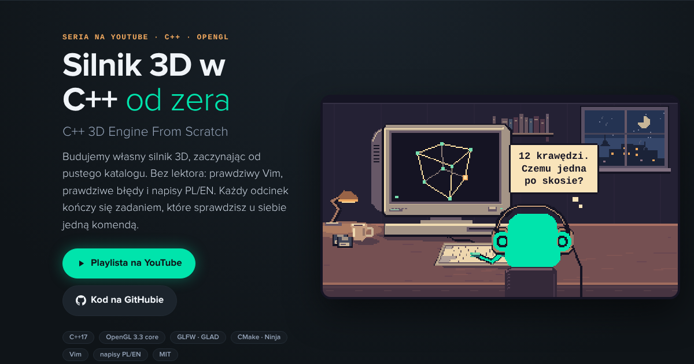
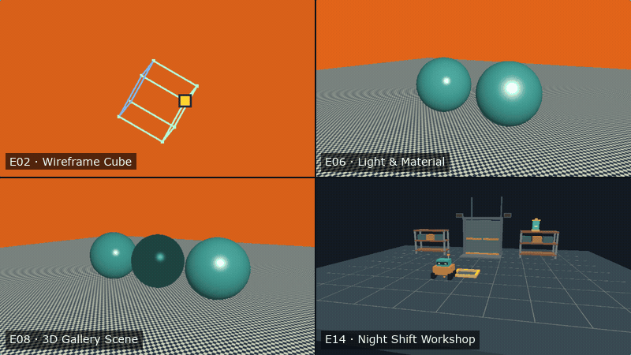
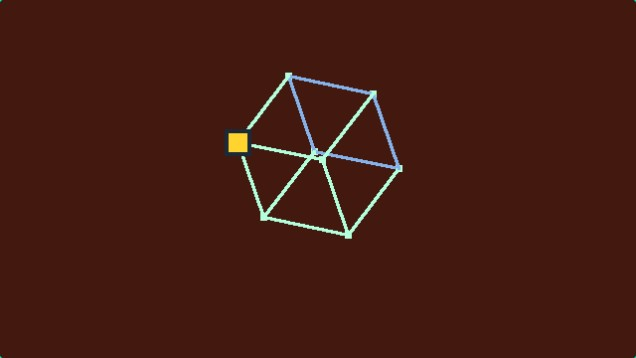
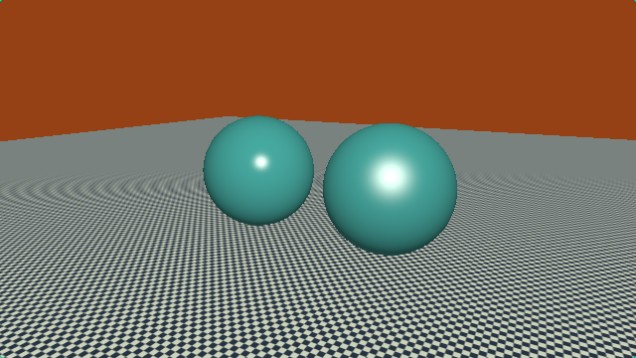
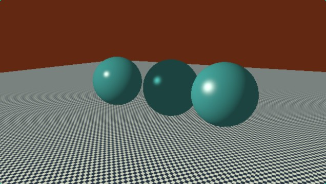
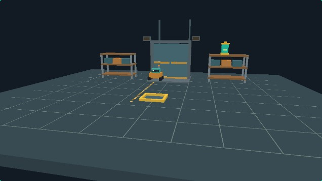
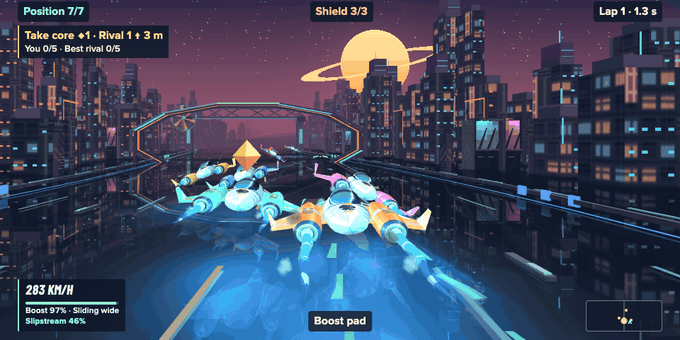
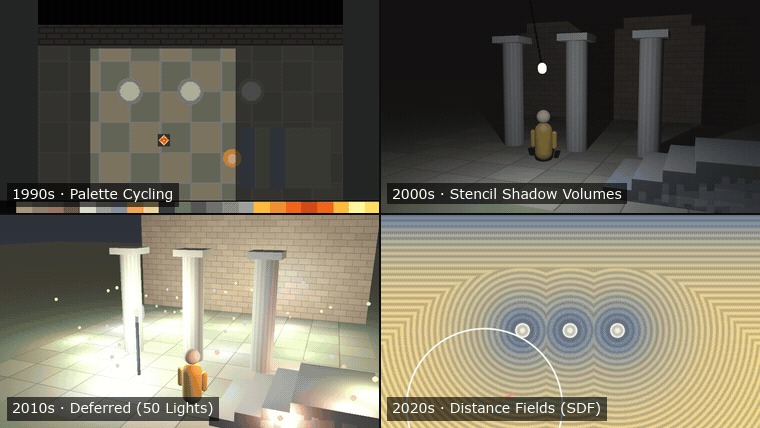

<div align="center">

# Silnik 3D w C++ od zera

**Od pustego katalogu do własnego silnika 3D w C++17 i OpenGL 3.3 — prawdziwy Vim, prawdziwe błędy, zadania po każdym odcinku i kompilacja każdego etapu do przeglądarki.**

[**Strona serii ↗**](https://gamedevpl.github.io/silnik3d-od-zera/) · [**Playlista YouTube ↗**](https://www.youtube.com/playlist?list=PLFf6J3zhiCW4) · [English README](README.en.md) · [Demko: Neon Canal](demko/README.md) · [Lumen Lab](docs/lumen-lab/README.md)


-f59e0b?style=flat-square)

<br>

<a href="https://gamedevpl.github.io/silnik3d-od-zera/">
  
</a>

</div>

---

## Ewolucja silnika — uruchom na żywo w przeglądarce

Każdy tag odcinka (`ep00`–`ep14`) buduje się automatycznie przez Emscripten do WebAssembly, więc możesz odpalić silnik z dowolnego etapu bez instalowania czegokolwiek:

<p align="center">
  <a href="https://gamedevpl.github.io/silnik3d-od-zera/play/?ep=ep14&lang=pl">
    
  </a>
</p>

<table>
  <tr>
    <td align="center" width="25%">
      <a href="https://gamedevpl.github.io/silnik3d-od-zera/play/?ep=ep02&lang=pl"></a><br>
      <sub><b><a href="https://gamedevpl.github.io/silnik3d-od-zera/play/?ep=ep02&lang=pl">E02 · Kostka ↗</a></b><br>Obrót i gimbal lock</sub>
    </td>
    <td align="center" width="25%">
      <a href="https://gamedevpl.github.io/silnik3d-od-zera/play/?ep=ep06&lang=pl"></a><br>
      <sub><b><a href="https://gamedevpl.github.io/silnik3d-od-zera/play/?ep=ep06&lang=pl">E06 · Światło ↗</a></b><br>Normalne i chropowatość</sub>
    </td>
    <td align="center" width="25%">
      <a href="https://gamedevpl.github.io/silnik3d-od-zera/play/?ep=ep08&lang=pl"></a><br>
      <sub><b><a href="https://gamedevpl.github.io/silnik3d-od-zera/play/?ep=ep08&lang=pl">E08 · Scena ↗</a></b><br>Uchwyty i galeria 3D</sub>
    </td>
    <td align="center" width="25%">
      <a href="https://gamedevpl.github.io/silnik3d-od-zera/play/?ep=ep14&lang=pl"></a><br>
      <sub><b><a href="https://gamedevpl.github.io/silnik3d-od-zera/play/?ep=ep14&lang=pl">E14 · Warsztat ↗</a></b><br>Sezon 2: pierwsza gra</sub>
    </td>
  </tr>
</table>

---

## Co jeszcze żyje w tym repo?

<table>
  <tr>
    <td align="center" width="50%" valign="top">
      <a href="./demko/README.md"></a><br>
      <b><a href="./demko/README.md">Neon Canal (Demko)</a></b> · <a href="https://gamedevpl.github.io/silnik3d-od-zera/demko/">Zagraj w przeglądarce ↗</a><br>
      <sub>Wyścigowa gra 3D w C++17 / WASM i natywnym Metal na macOS — 7 statków, rozwidlenia, smuga, dopalacz i rakiety.</sub>
    </td>
    <td align="center" width="50%" valign="top">
      <a href="./docs/lumen-lab/README.md"></a><br>
      <b><a href="./docs/lumen-lab/README.md">Lumen Lab</a></b> · <a href="https://gamedevpl.github.io/silnik3d-od-zera/lumen-lab/">Uruchom w WebGL2 ↗</a><br>
      <sub>40 lat światła i cienia w grach (31 żywych scen: paleta, blob, lightmapa, stencil, shadow map, deferred, path tracing, SDF).</sub>
    </td>
  </tr>
</table>

---

## Ćwiczenia po odcinkach

Wybierz gałąź startową swojego odcinka — dostajesz dokładnie ten sam kod co w filmie, z jednym zepsutym miejscem i skryptem `check.py`, który sprawdza poprawkę:

```sh
git clone -b e00-start https://github.com/gamedevpl/silnik3d-od-zera.git
cd silnik3d-od-zera
python3 check.py
```

*W paczce offline zastąp adres HTTPS ścieżką `silnik-3d.bundle silnik3d-od-zera`. E00–E02 wymagają Git, Pythona 3 i kompilatora C++17; od E03 potrzebne są też CMake 3.20+, Ninja i OpenGL 3.3 (na Debianie/Ubuntu: `sudo apt install pkg-config xorg-dev libwayland-dev libxkbcommon-dev`).*

### Sezon 1 — Od pustego katalogu do sceny 3D (`E00`–`E08`)

| Odcinek | Zadanie | Start | Rozwiązanie | Tag | Przeglądarka |
| --- | --- | --- | --- | --- | --- |
| **E00** · Pierwsze okno | Przywróć puls tła w `frame.hpp` | [`e00-start`](https://github.com/gamedevpl/silnik3d-od-zera/tree/e00-start) | [`e00-solution`](https://github.com/gamedevpl/silnik3d-od-zera/tree/e00-solution) | [`ep00`](https://github.com/gamedevpl/silnik3d-od-zera/tree/ep00) | [Uruchom ↗](https://gamedevpl.github.io/silnik3d-od-zera/play/?ep=ep00&lang=pl) |
| **E01** · Pętla gry i stały krok | Ogranicz nadrabianie po długiej klatce w `clock.hpp` | [`e01-start`](https://github.com/gamedevpl/silnik3d-od-zera/tree/e01-start) | [`e01-solution`](https://github.com/gamedevpl/silnik3d-od-zera/tree/e01-solution) | [`ep01`](https://github.com/gamedevpl/silnik3d-od-zera/tree/ep01) | [Uruchom ↗](https://gamedevpl.github.io/silnik3d-od-zera/play/?ep=ep01&lang=pl) |
| **E02** · Kostka i gimbal lock | Wyprostuj boczne krawędzie kostki w `mesh.hpp` | [`e02-start`](https://github.com/gamedevpl/silnik3d-od-zera/tree/e02-start) | [`e02-solution`](https://github.com/gamedevpl/silnik3d-od-zera/tree/e02-solution) | [`ep02`](https://github.com/gamedevpl/silnik3d-od-zera/tree/ep02) | [Uruchom ↗](https://gamedevpl.github.io/silnik3d-od-zera/play/?ep=ep02&lang=pl) |
| **E03** · Pierwsza pełna ściana | Pobierz trzeci wierzchołek trójkąta w `face.hpp` | [`e03-start`](https://github.com/gamedevpl/silnik3d-od-zera/tree/e03-start) | [`e03-solution`](https://github.com/gamedevpl/silnik3d-od-zera/tree/e03-solution) | [`ep03`](https://github.com/gamedevpl/silnik3d-od-zera/tree/ep03) | [Uruchom ↗](https://gamedevpl.github.io/silnik3d-od-zera/play/?ep=ep03&lang=pl) |
| **E04** · Kamera i głębia | Włącz test głębi w `depth.hpp` | [`e04-start`](https://github.com/gamedevpl/silnik3d-od-zera/tree/e04-start) | [`e04-solution`](https://github.com/gamedevpl/silnik3d-od-zera/tree/e04-solution) | [`ep04`](https://github.com/gamedevpl/silnik3d-od-zera/tree/ep04) | [Uruchom ↗](https://gamedevpl.github.io/silnik3d-od-zera/play/?ep=ep04&lang=pl) |
| **E05** · Tekstura w ruchu | Dobierz filtr dla mipmap w `texture.hpp` | [`e05-start`](https://github.com/gamedevpl/silnik3d-od-zera/tree/e05-start) | [`e05-solution`](https://github.com/gamedevpl/silnik3d-od-zera/tree/e05-solution) | [`ep05`](https://github.com/gamedevpl/silnik3d-od-zera/tree/ep05) | [Uruchom ↗](https://gamedevpl.github.io/silnik3d-od-zera/play/?ep=ep05&lang=pl) |
| **E06** · Światło i materiał | Przekaż właściwą chropowatość w `lighting.hpp` | [`e06-start`](https://github.com/gamedevpl/silnik3d-od-zera/tree/e06-start) | [`e06-solution`](https://github.com/gamedevpl/silnik3d-od-zera/tree/e06-solution) | [`ep06`](https://github.com/gamedevpl/silnik3d-od-zera/tree/ep06) | [Uruchom ↗](https://gamedevpl.github.io/silnik3d-od-zera/play/?ep=ep06&lang=pl) |
| **E07** · Siatka jako zasób | Jeden odczyt dla dwóch ścieżek w `asset_cache.hpp` | [`e07-path-start`](https://github.com/gamedevpl/silnik3d-od-zera/tree/e07-path-start) | [`e07-solution`](https://github.com/gamedevpl/silnik3d-od-zera/tree/e07-solution) | [`ep07`](https://github.com/gamedevpl/silnik3d-od-zera/tree/ep07) | [Uruchom ↗](https://gamedevpl.github.io/silnik3d-od-zera/play/?ep=ep07&lang=pl) |
| **E08** · Scena i uchwyty | Odrzuć uchwyt starej generacji w `scene.hpp` | [`e08-start`](https://github.com/gamedevpl/silnik3d-od-zera/tree/e08-start) | [`e08-solution`](https://github.com/gamedevpl/silnik3d-od-zera/tree/e08-solution) | [`ep08`](https://github.com/gamedevpl/silnik3d-od-zera/tree/ep08) | [Uruchom ↗](https://gamedevpl.github.io/silnik3d-od-zera/play/?ep=ep08&lang=pl) |

### Sezon 2 · Nocna zmiana — pierwsza gra na własnym silniku (`E09`–`E14`)

| Odcinek | Zadanie | Start | Rozwiązanie | Tag | Przeglądarka |
| --- | --- | --- | --- | --- | --- |
| **E09** · Pierwsza jazda robota | Wyrównaj prędkość po skosie w `drive.hpp` | [`e09-start`](https://github.com/gamedevpl/silnik3d-od-zera/tree/e09-start) | [`e09-solution`](https://github.com/gamedevpl/silnik3d-od-zera/tree/e09-solution) | [`ep09`](https://github.com/gamedevpl/silnik3d-od-zera/tree/ep09) | [Uruchom ↗](https://gamedevpl.github.io/silnik3d-od-zera/play/?ep=ep09&lang=pl) |
| **E10** · Ściana | Poprowadź robota wzdłuż regału w `collision.hpp` | [`e10-start`](https://github.com/gamedevpl/silnik3d-od-zera/tree/e10-start) | [`e10-solution`](https://github.com/gamedevpl/silnik3d-od-zera/tree/e10-solution) | [`ep10`](https://github.com/gamedevpl/silnik3d-od-zera/tree/ep10) | [Uruchom ↗](https://gamedevpl.github.io/silnik3d-od-zera/play/?ep=ep10&lang=pl) |
| **E11** · Podnieś ogniwo | Rozpoznaj pojedyncze naciśnięcie `E` w `cell.hpp` | [`e11-start`](https://github.com/gamedevpl/silnik3d-od-zera/tree/e11-start) | [`e11-solution`](https://github.com/gamedevpl/silnik3d-od-zera/tree/e11-solution) | [`ep11`](https://github.com/gamedevpl/silnik3d-od-zera/tree/ep11) | [Uruchom ↗](https://gamedevpl.github.io/silnik3d-od-zera/play/?ep=ep11&lang=pl) |
| **E12** · Gniazdo zasila warsztat | Sprawdź całą podstawę ogniwa w `socket.hpp` | [`e12-start`](https://github.com/gamedevpl/silnik3d-od-zera/tree/e12-start) | [`e12-solution`](https://github.com/gamedevpl/silnik3d-od-zera/tree/e12-solution) | [`ep12`](https://github.com/gamedevpl/silnik3d-od-zera/tree/ep12) | [Uruchom ↗](https://gamedevpl.github.io/silnik3d-od-zera/play/?ep=ep12&lang=pl) |
| **E13** · Słychać, że działa | Odtwórz kliknięcie zatrzasku raz w `sound.hpp` | [`e13-start`](https://github.com/gamedevpl/silnik3d-od-zera/tree/e13-start) | [`e13-solution`](https://github.com/gamedevpl/silnik3d-od-zera/tree/e13-solution) | [`ep13`](https://github.com/gamedevpl/silnik3d-od-zera/tree/ep13) | [Uruchom ↗](https://gamedevpl.github.io/silnik3d-od-zera/play/?ep=ep13&lang=pl) |
| **E14** · Jeszcze jedna próba | Wyzeruj stan windy po `R` w `shift.hpp` | [`e14-start`](https://github.com/gamedevpl/silnik3d-od-zera/tree/e14-start) | [`e14-solution`](https://github.com/gamedevpl/silnik3d-od-zera/tree/e14-solution) | [`ep14`](https://github.com/gamedevpl/silnik3d-od-zera/tree/ep14) | [Uruchom ↗](https://gamedevpl.github.io/silnik3d-od-zera/play/?ep=ep14&lang=pl) |

---

## Budowanie natywne (C++17 · CMake · Ninja)

GLFW i GLAD leżą w katalogu `vendor/` wraz z licencjami. Z głównego katalogu repozytorium:

```sh
cmake -S . -B build -G Ninja
cmake --build build
./build/engine
```

---

## Powtórz eksperymenty z filmów (E00–E02)

Na gałęzi `main` leżą próbniki (`replay`, `steer`, `frame`, `probe`), które odtwarzają dokładnie pomiary pokazane w pierwszych trzech odcinkach bez psucia Twojej gałęzi:

| Odcinek | Long | Short |
| --- | --- | --- |
| **E00** | `python3 replay setup` · `python3 probe-swaps` · `python3 replay clock` | `python3 replay pulse` |
| **E01** | `python3 replay 01` · `python3 replay landing` · `python3 replay steps` | `python3 replay race` |
| **E02** | `python3 replay 02` · `python3 replay corners` · `python3 replay turns` · `python3 steer ep02` | `python3 replay edges` |

<details>
<summary><b>E00 · Krok po kroku w Vimie (pierwszy plik, Ninja, GLAD/GLFW, zegar)</b></summary>

### Jak zacząć od E00

W klonie zacznij od `git clone https://github.com/gamedevpl/silnik3d-od-zera.git` i `cd silnik3d-od-zera`. Jeśli korzystasz z paczki, rozpakuj `silnik-3d.zip` i otwórz terminal w katalogu z plikiem `replay`.

Aby dokładnie powtórzyć ruchy w Vimie, zacznij w tym samym katalogu. Paczka zawiera już plik `silnik-3d.bundle`. W klonie utwórz go poleceniem `git bundle create silnik-3d.bundle HEAD main --tags`. Następnie utwórz `work/engine` i przejdź do niego. W tym miejscu `git clone -q ../../silnik-3d.bundle ../../ref` tworzy kopię do podglądu, a `cp -R ../../ref/vendor .` umieszcza biblioteki w budowanym projekcie.

### Co zapisuje Vim, a co uruchamia powłoka

```sh
mkdir -p work/engine && cd work/engine && vim main.cpp
```

Wpisz `int main() {}` i zapisz `:w`. Wykonaj `:!c++ main.cpp -o hello`, potem `:!./hello; echo $?` (kod wyjścia `0`). Dopisz `#include <cstdio>` i `std::puts("engine online");`, zapisz plik i uruchom `./hello` — stary plik binarny nic nie wypisuje (`:!ls -1t main.cpp hello`). Przekompiluj i uruchom ponownie, żeby zobaczyć `engine online`.

### Co właściwie zbudował Ninja?

W Vimie otwórz `:e CMakeLists.txt`, wpisz:

```cmake
cmake_minimum_required(VERSION 3.20)
project(Engine LANGUAGES C CXX)
set(CMAKE_CXX_STANDARD 17)
```

Uruchom `:!cmake -S . -B build -G Ninja` oraz `:!cmake --build build && ./build/engine` — Ninja zgłosi `no work to do`. Dopisz `add_executable(engine main.cpp)`, zapisz `:w` i powtórz `:!!`.

### Od pierwszego include do uruchomienia GLAD

```sh
git clone -b ep00-unlinked-glfw . proba-glfw && cd proba-glfw && vim CMakeLists.txt
```

(W paczce offline użyj `silnik-3d.bundle` zamiast `.`). Po `:!cmake -S . -B build -G Ninja` i `:!cmake --build build && ./build/engine` brakuje `glfw` przy `PRIVATE glad`. Dopisz `glfw ` przed `glad`, zapisz `:w` i powtórz `:!!` — program wypisze `GLFW ready`. Różnicę pokaże `git diff ep00-unlinked-glfw ep00-glfw-ready -- CMakeLists.txt`.

Z katalogu głównego uruchom `python3 replay setup` (porównanie 7 etapów budowania i wersji kontekstu OpenGL) oraz `git diff ep00-loader-before ep00-loader-after -- main.cpp`.

### Short E00 · zegar i zatrzymany puls

```sh
python3 replay pulse
git worktree add --detach ../pulse-edit ep00-unused-elapsed
```

W `../pulse-edit/frame.hpp` zmień `cos(start * 1.8)` na `cos(elapsed * 1.8)` i uruchom `python3 replay pulse --source ../pulse-edit`.

Dla pomiaru `static` z 5:11:

```sh
git worktree add --detach ref ep00-static-elapsed
cd ref && python3 ../probe . arg --start-time 0.2
```

Usuń `static` w `ref/frame.hpp` i powtórz polecenie (drugi argument wzrośnie z `0` do `1,800`). Z `work/engine` możesz też mierzyć liczbę zamian buforów przez `python3 ../../probe-swaps .`.

</details>

<details>
<summary><b>E01 · Krok po kroku (stały krok 20 ms, lądowanie, skok przy 15 i 240 FPS)</b></summary>

### Jedna długa klatka bez OpenGL

```sh
git clone -b ep01-clock-coupled . clock-edit && cd clock-edit && vim clock.hpp
```

Uruchom `:!python3 ../frame 3` — kompilator zatrzyma się na `player.update(tick)`. Zmień `tick` na `step` i powtórz `:!!` (16 kroków po 20 ms, 13,333 ms reszty). Dodaj `#include <algorithm>` i zmień `lag += elapsed;` na `lag += std::min(elapsed, 0.25);` — zegar przyjmie 250 ms, zrobi 12 kroków i zostawi 10 ms.

### Dlaczego kwadrat stanął przy 240 FPS?

`python3 replay steps` porównuje 30 i 240 FPS (warunek `if` vs pętla `while`). Własna próba:

```sh
git worktree add --detach ../test-clock ep01-inline-bank
# zamień if (lag >= 0.02) na while (lag >= 0.02) w ../test-clock/main.cpp
python3 replay steps --source ../test-clock
```

### Lądowanie na podłodze i test nożycowy

`python3 replay landing` porównuje `ep01-fall`, `ep01-clamp` i `ep01-bounce`. Własna zmiana:

```sh
git worktree add --detach ../skok ep01-clamp
# dopisz speed = 120; pod height = 0; w ../skok/frame.hpp
python3 replay landing --source ../skok
```

`python3 replay 01` oraz `python3 ../../probe-scissor .` badają `GL_SCISSOR_TEST` i różnicę kroków przy 30 vs 240 FPS.

### Short E01 · skok przy 15 FPS

```sh
python3 replay race
git worktree add --detach ref ep01-matched-tick && cd ref && vim clock.hpp
```

W Vimie uruchom `:!python3 ../frame 15` (zostaje 33,333 ms). Zmień `if (lag >= tick)` na `while (lag >= tick)`, zapisz `:w` i ponów `:!!` (reszta spada do 0; `:!python3 ../race 15` porównuje lądowania).

</details>

<details>
<summary><b>E02 · Krok po kroku (krawędzie kostki, stopnie/radiany, minus przy roll, gimbal lock)</b></summary>

### Short E02 · skąd się wzięła przekątna

```sh
git clone -b ep02-marked-rings . ref && cd ref && vim mesh.hpp
```

(W paczce offline użyj `silnik-3d.bundle` zamiast `.`). W Vimie `:!python3 ../replay edges --source .` sprawdza krawędzie bez grafiki (`ep02-crossed-sides` daje `1->6`, naprawiony `ep02-wire` daje `0->4 1->5 2->6 3->7`). `python3 replay edges` porównuje trzy etapy naraz.

### Punkty i pełny obrót (stopnie vs radiany)

```sh
python3 replay corners
python3 replay turns
git worktree add --detach ../turn ep02-turn-360
# zamień aboutY(p,360) na aboutY(p,radians(360)) w ../turn/mesh.hpp
python3 replay turns --source ../turn
```

### Test przy 89° i 90°, minus przy roll i sterowanie kostką

```sh
python3 replay 02
python3 steer ep02-euler        # Y potem Z przy pochyleniu 90° wraca do pierścienia
python3 steer ep02-quat-euler   # kwaterniony z 3 kątów nadal wracają
python3 steer ep02              # jedna orientacja, lokalne osie — omija start
```

Bez Tkinter/Pillow uruchom `python3 steer ep02-euler --trace` (`0,000000`) i `python3 steer ep02 --trace` (`1,780891`).
Test osi w C++: `c++ -std=c++17 axes.cpp -o axes && ./axes 60 && ./axes 90`.
W silniku natywnym ustaw `TURN=yaw` lub `TURN=roll` i `PITCH=60` lub `PITCH=90`.

</details>

<details>
<summary><b>Lista tagów pośrednich (E00–E02)</b></summary>

- `start` – pusty katalog
- `ep00-hello` – `c++ main.cpp -o hello && ./hello`
- `ep00-window` – pierwsze pomarańczowe okno
- `ep00-frozen` – kolor utknął (start Shorta E00)
- `ep00` – pulsujące tło (start longa E01)
- `ep01-variable` – skok zależny od FPS
- `ep01-clock` – zegar jeszcze niepodłączony
- `ep01-single-step` – 1 zaległy krok przy 30 FPS (start Shorta E01)
- `ep01` – stały krok 20 ms
- `ep02-flat` / `ep02-wire` / `ep02-euler` / `ep02-quat-euler` / `ep02` – etapy kostki i obrotów

</details>

---

## Więcej projektów od [gamedev.pl](https://www.gamedev.pl)

- **[FX Lab](https://github.com/gamedevpl/fx-lab)** — 32 interaktywne efekty graficzne WebGL2 & WebGPU
- **[Game Design Codex (GDC)](https://github.com/gamedevpl/gdc)** — 22 grywalne mechaniki gier 3D
- **[www.gamedev.pl](https://github.com/gamedevpl/www.gamedev.pl)** — otwarty kod platformy gamedev.pl

## Licencja

Kod serii udostępniony na licencji MIT (biblioteki GLFW i GLAD w [`vendor/`](./vendor/) zawierają własne pliki licencji).
