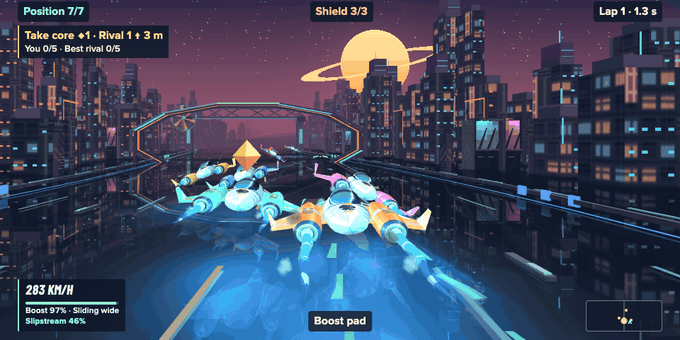
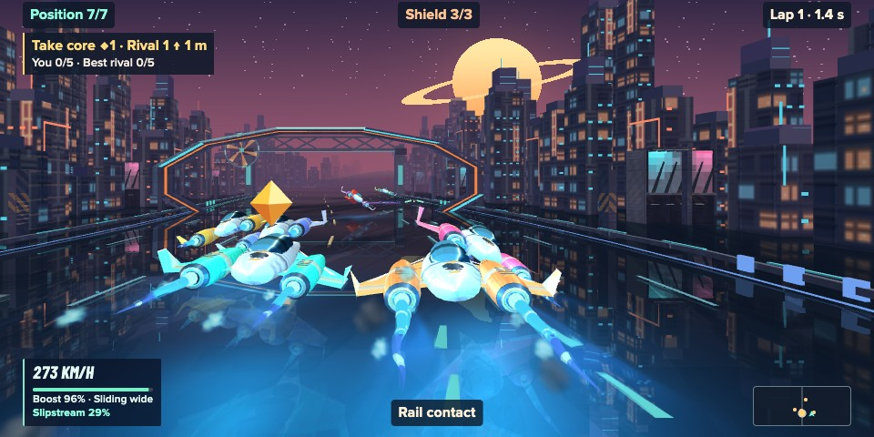
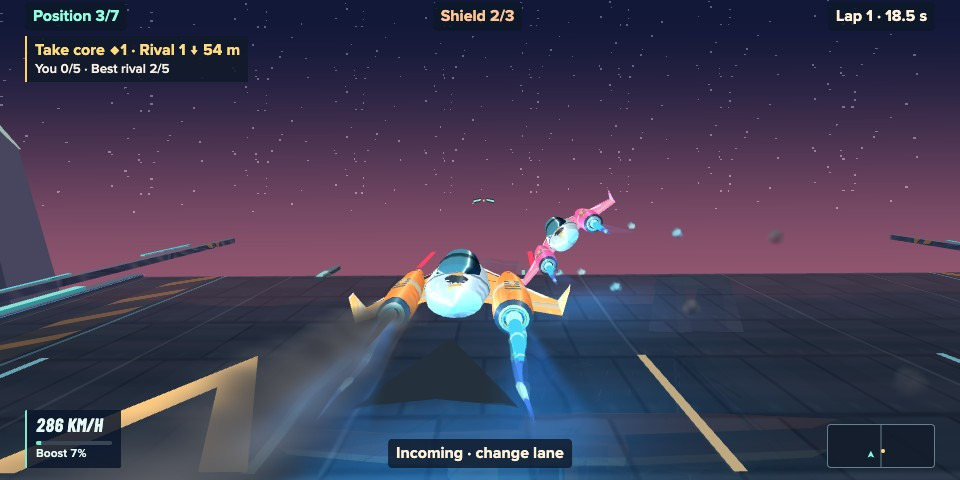
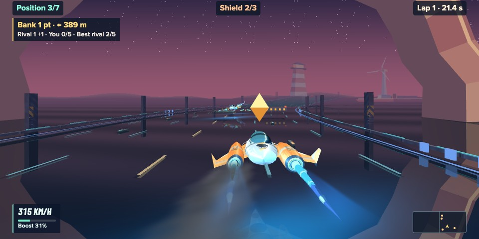

<div align="center">

# Neon Canal (Demko)

**3D C++ anti-gravity neon racer compiled to WebAssembly (WebGL2 / Canvas 2D) and native macOS Metal.**

[**Play Neon Grand Prix in Your Browser ↗**](https://gamedevpl.github.io/silnik3d-od-zera/demko/) · [Silnik 3D od zera](../README.md) · [Lumen Lab](../docs/lumen-lab/README.md) · [gamedev.pl](https://www.gamedev.pl)


<br>

<a href="https://gamedevpl.github.io/silnik3d-od-zera/demko/">
  
</a>

*Seven ships, a 2,304-unit split-route harbor circuit, slipstream slingshots, core-relay combat, and zero engine dependencies.*

</div>

---

## Screenshots

<table>
  <tr>
    <td align="center" width="33%">
      <a href="https://gamedevpl.github.io/silnik3d-od-zera/demko/"></a><br>
      <sub><b>Neon Harbor Pack</b> — 7 ships, mirrored canal &amp; skyline</sub>
    </td>
    <td align="center" width="33%">
      <a href="https://gamedevpl.github.io/silnik3d-od-zera/demko/"></a><br>
      <sub><b>Split Routes &amp; Jumps</b> — raised bridge vs low recharge canal</sub>
    </td>
    <td align="center" width="33%">
      <a href="https://gamedevpl.github.io/silnik3d-od-zera/demko/"></a><br>
      <sub><b>Core Relay</b> — carry the gold diamond &amp; bank for up to 3 pts</sub>
    </td>
  </tr>
</table>

---

## How the race works

- **Core Relay (first to 5 pts):** One ship carries the **gold diamond**. Hit the carrier or overtake within 4.8 m alongside on the same deck to steal it. Fly through the gold gate to bank `1 pt`, or skip it to raise the stake up to `3 pts` (missing at 3 drops the core).
- **Split routes & jumps:** Before the island, pick the **high suspension bridge** (tailwind, raises core stakes) or the **low canal** (recharges boost, hosts the first gold gate). Clear the harbor viaduct gap and waterfront launch rails between the mint landing lights for `+12` energy and an exit boost.
- **Slipstream slingshot & Overdrive:** Tuck into a rival's teal wake for ~1 s without boost, then steer out while boosting to slingshot. Over **violet chevrons**, coast for a standard payout (`+24` energy, `+1` shield, rocket every second pad) — or hold **Boost** with `≥ 35` energy to trigger 2.35 s of **Overdrive**.
- **Combat & hull damage:** Fire straight cannon bolts (`Space`) or track-following rockets (`R`) at rivals and sweeping amber barriers. Watch the two-note lane warning for incoming rival fire. Scraping rails scrubs speed and throws sparks; engines smoke at `2/3` shield, burn at `1/3`, and break apart at `0`.

## Controls

| Control | Action |
| --- | --- |
| **`←` `→`** or **`A` / `D`** | Steer (or sideways drag / two-finger trackpad swipe) |
| **`↑`** or **`W`** | Boost (12 s full cell; release to recharge) |
| **`Q` / `E`** or **`↓` / `S`** | Left / right airbrake · sustained airbrake for tight corners |
| **`Space`** / **`R`** | Fire cannon / launch rocket |
| **`P`** or **`Esc`** | Pause or resume · **`M`** (macOS) toggles sound |

Press **Space**, click, or tap the race view to start. On touchscreens, steer with one thumb and hold **Boost** with the other. Switch between **EN** and **PL** in the top bar (or app menu on macOS).

*Audio:* Plays the original 150 BPM soundtrack from *I have a vibe, for a new game* alongside a pitch-ramped stereo ion-drive loop (up to 2.1× on boost) and C++-synthesized cannon, rocket, rail-scrape, and breakup effects.

---

## Source code

| Area | File |
| --- | --- |
| Race physics, rival AI & collisions (C++) | [`race.hpp`](./race.hpp) |
| Ship hulls, nacelles, cockpits & team paint | [`racer.hpp`](./racer.hpp) |
| Track geometry, lane markings & exhausts | [`demo.cpp`](./demo.cpp) · [`track_mesh.hpp`](./track_mesh.hpp) |
| Procedural textures, windows & flame maps | [`materials.hpp`](./materials.hpp) |
| Sparks, damaged engines & hull fragments | [`damage_fx.hpp`](./damage_fx.hpp) |
| Synthesized race SFX & ion-drive loop | [`sound_bank.hpp`](./sound_bank.hpp) · [`ion-drive.flac`](../docs/demko/ion-drive.flac) |
| Canvas 2D software projection fallback | [`canvas_scene.hpp`](./canvas_scene.hpp) |
| Browser WebGL2 / Canvas, HUD & audio | [`renderer.js`](../docs/demko/renderer.js) · [`app.js`](../docs/demko/app.js) · [`audio.js`](../docs/demko/audio.js) |

---

## Run or build

### Browser (WebAssembly + WebGL2)

Serve the prebuilt files from the repository root and open <http://localhost:8000/demko/>:

```sh
python3 -m http.server --directory docs 8000
```

To rebuild `docs/demko/flight.wasm` (requires WASI SDK 34 in `WASI_SDK_PATH`) and run the 7-lap native C++ vs WASM parity test:

```sh
./demko/build.sh
node --test demko/tests/endless.mjs
```

### Native macOS (Metal + AVFoundation)

Requires macOS 13+, a Metal-capable GPU, and Apple Command Line Tools. Shares the exact same C++ simulation and ship models as the browser build:

```sh
./demko/macos/build.sh
open 'build/macos/Neon Canal.app'
```
