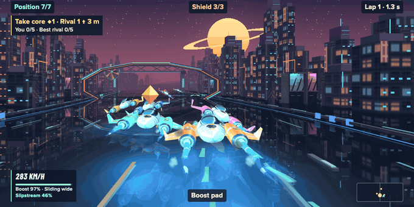

# Neon Canal — browser build

[**Play the game ↗**](https://gamedevpl.github.io/silnik3d-od-zera/demko/) · [C++ source &amp; build instructions](../../demko/README.md) · [Silnik 3D od zera](../../README.md)

 

GitHub Pages serves the browser version straight from this directory:

- **`flight.wasm`** — race rules, physics, rival AI, track meshes, ship hulls, and Canvas 2D fallback compiled from C++17.
- **`renderer.js` · `app.js` · `audio.js`** — WebGL2/Canvas bindings, controls, HUD, 150 BPM soundtrack, and synthesized SFX.
- **`assistant.js`** — optional mascot assistant backed by `source.json`.

See [`demko/README.md`](../../demko/README.md) for full gameplay rules, controls, C++ source map, and local WASM / native macOS Metal builds.
