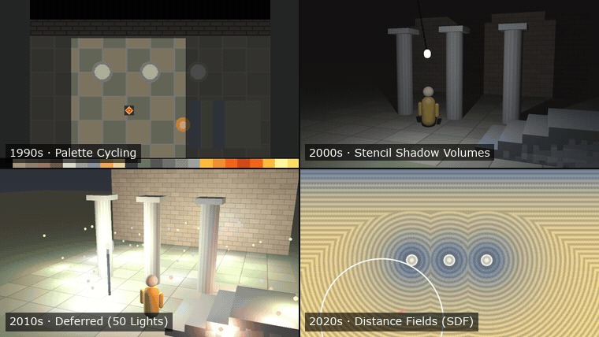
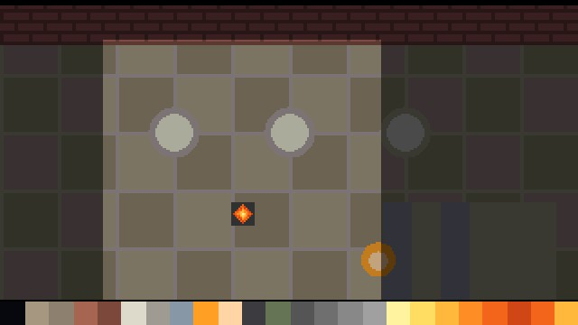
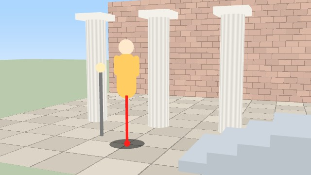
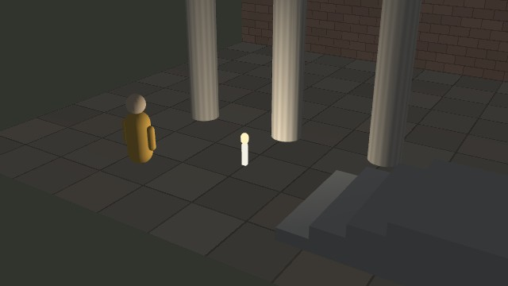
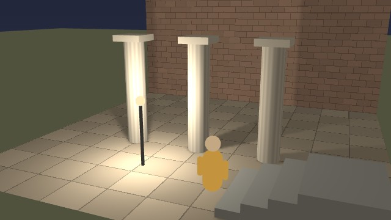
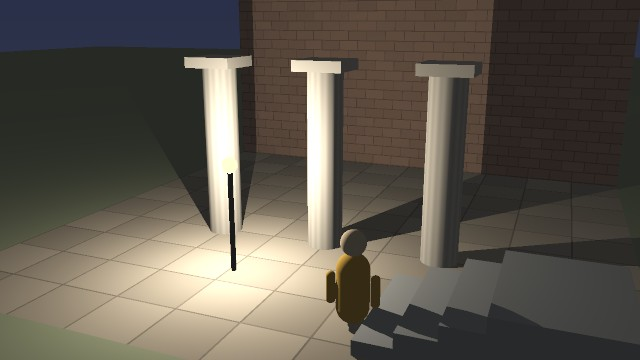
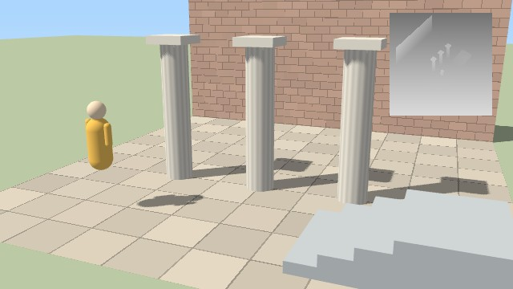
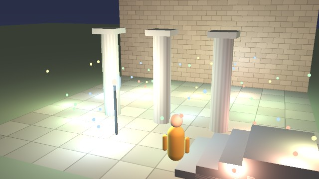
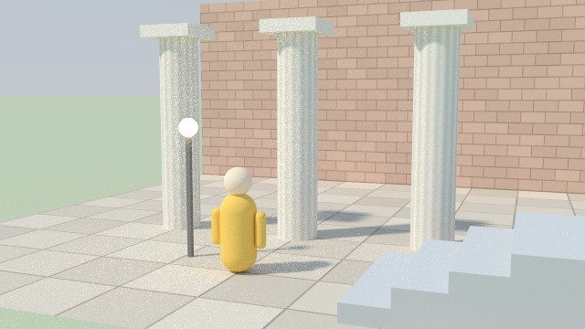
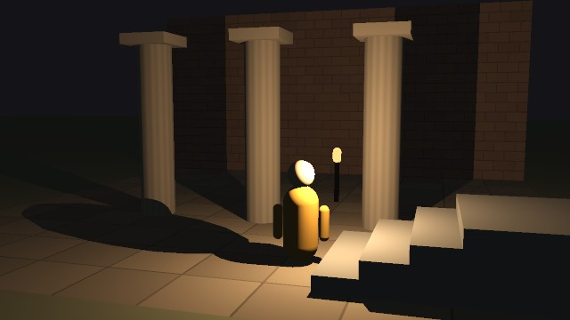

<div align="center">

# Lumen Lab

**40 lat światła i cienia w grach — jedna scena, 31 żywych ujęć w surowym WebGL2.**<br>
*Forty years of real-time lighting and shadows in one scene — plain JavaScript & raw WebGL2, zero build step.*

[**Uruchom w przeglądarce / Launch Live ↗**](https://gamedevpl.github.io/silnik3d-od-zera/lumen-lab/) · [Silnik 3D od zera](../../README.md) · [Neon Canal (Demko)](../../demko/README.md) · [FX Lab](https://github.com/gamedevpl/fx-lab) · [gamedev.pl](https://www.gamedev.pl)


<br>

<a href="https://gamedevpl.github.io/silnik3d-od-zera/lumen-lab/">
  
</a>

*Demo do filmu „Ujarzmić fotony: 40 lat światła i cienia w grach” ([GamedevPL na YouTube](https://www.youtube.com/@gamedev_pl)). / Companion demo for our video essay on light and shadow in games.*

</div>

---

## Rozdziały · Chapters

Kliknij dowolny kadr, żeby uruchomić tę technikę na żywo w przeglądarce (każdy kadr to ta sama scena: trzy kolumny, postać i latarnia).<br>
*Click any frame to jump straight into that shot live in WebGL2.*

<table>
  <tr>
    <td align="center" width="33%" valign="top">
      <a href="https://gamedevpl.github.io/silnik3d-od-zera/lumen-lab/?shot=D0-b"></a><br>
      <b>1. <a href="https://gamedevpl.github.io/silnik3d-od-zera/lumen-lab/?shot=D0-b">Paleta · Palette</a></b><br>
      <sub>Światło jako wiersz w tablicy kolorów (CLUT) i cykl palety bez przeliczania sceny.</sub>
    </td>
    <td align="center" width="33%" valign="top">
      <a href="https://gamedevpl.github.io/silnik3d-od-zera/lumen-lab/?shot=D1-a-debug"></a><br>
      <b>2. <a href="https://gamedevpl.github.io/silnik3d-od-zera/lumen-lab/?shot=D1-a-debug">Kółko pod stopami · Blob Shadow</a></b><br>
      <sub>Jeden promień w dół (Mario 64 / Quake), kółko nad schodkiem i spłaszczony rzut.</sub>
    </td>
    <td align="center" width="33%" valign="top">
      <a href="https://gamedevpl.github.io/silnik3d-od-zera/lumen-lab/?shot=D2-b"></a><br>
      <b>3. <a href="https://gamedevpl.github.io/silnik3d-od-zera/lumen-lab/?shot=D2-b">Wierzchołki · Gouraud</a></b><br>
      <sub>Światło w rogach czworokąta, gęstsza siatka vs oświetlenie na piksel.</sub>
    </td>
  </tr>
  <tr>
    <td align="center" width="33%" valign="top">
      <a href="https://gamedevpl.github.io/silnik3d-od-zera/lumen-lab/?shot=D3-b-final"></a><br>
      <b>4. <a href="https://gamedevpl.github.io/silnik3d-od-zera/lumen-lab/?shot=D3-b-final">Lightmapa · Baked Lightmap</a></b><br>
      <sub>Wypiekanie przed grą, mnożenie tekstura × lightmapa i brak cienia postaci w ruchu.</sub>
    </td>
    <td align="center" width="33%" valign="top">
      <a href="https://gamedevpl.github.io/silnik3d-od-zera/lumen-lab/?shot=D5-clean"></a><br>
      <b>5. <a href="https://gamedevpl.github.io/silnik3d-od-zera/lumen-lab/?shot=D5-clean">Bryły cieni · Shadow Volumes</a></b><br>
      <sub>Ostre jak żyletka cienie (Doom 3), Z-pass vs Z-fail, overdraw i wyciek z dziury w siatce.</sub>
    </td>
    <td align="center" width="33%" valign="top">
      <a href="https://gamedevpl.github.io/silnik3d-od-zera/lumen-lab/?shot=D4-a"></a><br>
      <b>6. <a href="https://gamedevpl.github.io/silnik3d-od-zera/lumen-lab/?shot=D4-a">Mapa cieni · Shadow Map</a></b><br>
      <sub>Bufor głębi z perspektywy słońca (1978), trądzik cienia (shadow acne) i peter panning.</sub>
    </td>
  </tr>
  <tr>
    <td align="center" width="33%" valign="top">
      <a href="https://gamedevpl.github.io/silnik3d-od-zera/lumen-lab/?shot=D6-a"></a><br>
      <b>7. <a href="https://gamedevpl.github.io/silnik3d-od-zera/lumen-lab/?shot=D6-a">Deferred, SSAO &amp; PBR</a></b><br>
      <sub>50 latarni naraz, G-buffer, kafelki 16×16, szkło w forward pass, SSAO i PBR.</sub>
    </td>
    <td align="center" width="33%" valign="top">
      <a href="https://gamedevpl.github.io/silnik3d-od-zera/lumen-lab/?shot=D7-a"></a><br>
      <b>8. <a href="https://gamedevpl.github.io/silnik3d-od-zera/lumen-lab/?shot=D7-a">Promienie · Path Tracing &amp; SDF</a></b><br>
      <sub>Monte Carlo path tracing, szum w ruchu, ReSTIR (wł./wył.) i pola odległości (SDF).</sub>
    </td>
    <td align="center" width="33%" valign="top">
      <a href="https://gamedevpl.github.io/silnik3d-od-zera/lumen-lab/?shot=M-torch"></a><br>
      <b>★ <a href="https://gamedevpl.github.io/silnik3d-od-zera/lumen-lab/?shot=M-torch">Klimat · Mood Scenes</a></b><br>
      <sub>Bujająca się latarnia i pochodnia niesiona przez kolumnadę — cienie liczone na żywo.</sub>
    </td>
  </tr>
</table>

---

## Sterowanie i uruchomienie lokalnie · Running locally

| Skrót / URL | Działanie / Action |
| --- | --- |
| **`←` / `→`** | Poprzednia / następna scena · Previous / next shot |
| **`Space`** | Pauza / wznów · Pause / resume |
| `?shot=D5-clean` | Bezpośredni link do dowolnego ujęcia (lista w [`src/shots.js`](./src/shots.js)) |

Czysty JavaScript i surowy WebGL2 — bez bibliotek i bez budowania / plain JS + raw WebGL2, no build step:

```sh
python3 -m http.server 8000 --directory docs
```

Otwórz / open: <http://localhost:8000/lumen-lab/>

<details>
<summary><b>Struktura i notatki techniczne · Technical notes</b></summary>

- This folder is the only copy; GitHub Pages serves it as is from `docs/lumen-lab/`.
- Page UI and chapter metadata live in [`src/app.js`](./src/app.js) and [`src/scenes.js`](./src/scenes.js); individual shot definitions in [`src/shots.js`](./src/shots.js).
- The optional mascot chat ([`src/assistant.js`](./src/assistant.js)) uses the shared `docs/ask/` panel and Chrome's built-in language model when available.

</details>

## Licence

MIT ([`LICENSE`](./LICENSE)). All code is our own. No id Software code is included; techniques are reimplemented from published papers (Williams 1978, Crow 1977, Heidmann 1991, Everitt & Kilgard 2002, Kajiya 1986, Bitterli et al. 2020 and others). Geometry and textures are procedural; no assets from any commercial game. Game and company names belong to their owners; this project is not affiliated with or endorsed by any of them.
